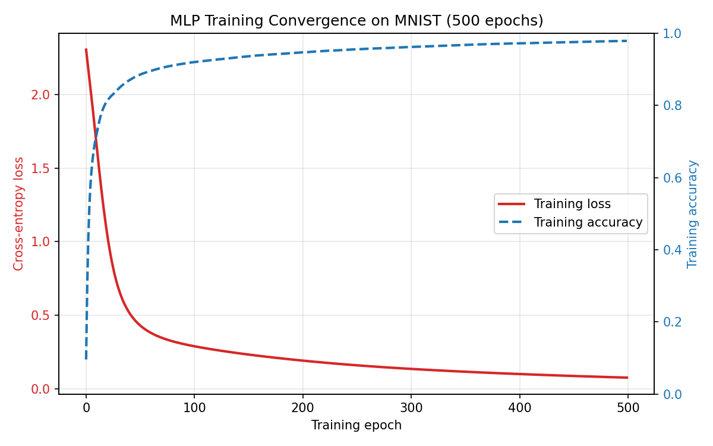
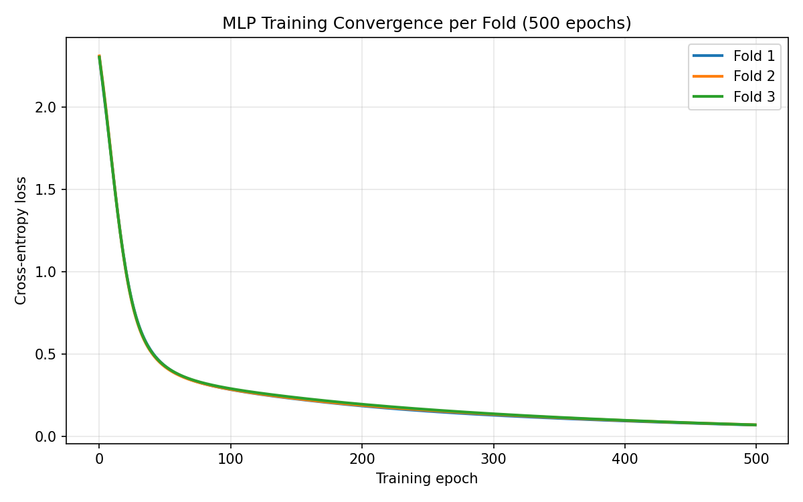

# Claudes-Plan — Stage 2: MLP on MNIST

A multi-layer perceptron built on the course source-code template, trained on the
MNIST handwritten-digit dataset and evaluated with Accuracy, Precision, Recall
and F1, plus a training-convergence plot. Decision Tree and SVM baselines are
included for comparison.

## Results

Measured on the 10,000-image test set (seeds fixed, so these are reproducible):

| Metric    | Score  |
|-----------|--------|
| Accuracy  | 0.9674 |
| Precision | 0.9672 |
| Recall    | 0.9671 |
| F1        | 0.9671 |

Precision, Recall and F1 are **macro-averaged** — computed per digit class and
then averaged with equal weight, so every class counts the same regardless of
how many test images it has.

Training converges smoothly, with cross-entropy loss falling from 2.303 at epoch
0 to about 0.07 at epoch 499:



### Baseline comparison

Two classical baselines are included, evaluated on the same test split:

| Model                       | Accuracy | Precision | Recall | F1     |
|-----------------------------|----------|-----------|--------|--------|
| **MLP** (784→128→10)        | 0.9674   | 0.9672    | 0.9671 | 0.9671 |
| SVM (RBF, C=1, 10k subset)  | 0.9637   | 0.9636    | 0.9634 | 0.9634 |
| Decision Tree               | 0.8757   | 0.8744    | 0.8742 | 0.8743 |

One caveat on the SVM row: kernel SVC scales roughly quadratically with
training-set size, so it was fit on a 10,000-image stratified subsample rather
than all 60,000. That is **not** a like-for-like comparison — the SVM saw a
sixth of the training data the other two models did.

### Cross-validated results

`--kfold` runs 3-fold cross-validation on `train.csv` and reports mean ± std
across folds:

```
python3 script/stage_2_script/script_mlp.py --kfold
```

| Metric    | Score (mean ± std) |
|-----------|--------------------|
| Accuracy  | 0.9629 ± 0.0015    |
| Precision | 0.9627 ± 0.0015    |
| Recall    | 0.9626 ± 0.0015    |
| F1        | 0.9626 ± 0.0015    |



Cross-validated accuracy (0.9629) sits slightly below the held-out test score
(0.9674) because each fold trains on 40,000 images rather than the full 60,000.

The fold shuffle is seeded (`--fold-seed`, default 2) so these numbers are
reproducible. Reshuffling moves them a little — seeds 1, 2 and 7 give accuracies
of 0.9615, 0.9629 and 0.9625 — so quote the seed alongside any cross-validated
figure.

## Dataset and train/test split

MNIST handwritten digits, supplied as CSV with one image per row: the first
value is the label (0–9) and the remaining 784 values are 28×28 grayscale pixels.
Pixels are scaled to `[0, 1]` by dividing by 255 at load time.

The split is **predefined by the dataset files**, not randomly generated — the
model trains only on `train.csv` and is evaluated only on `test.csv`:

| Split | File        | Images |
|-------|-------------|--------|
| Train | `train.csv` | 60,000 |
| Test  | `test.csv`  | 10,000 |

### Getting the data

The CSVs are not in this repository: `train.csv` is 109 MB, above GitHub's
100 MB per-file limit. Place the stage 2 files from the course template here:

```
data/stage_2_data/train.csv
data/stage_2_data/test.csv
```

Every script exits with a clear message if either file is missing.

## Model settings

A single hidden layer, trained full-batch:

| Setting               | Value                                               |
|-----------------------|-----------------------------------------------------|
| Architecture          | 784 → 128 (ReLU) → 10                               |
| Depth                 | 1 hidden layer (2 linear layers)                    |
| Loss                  | `nn.CrossEntropyLoss` (applies log-softmax internally) |
| Optimizer             | Adam                                                |
| Learning rate         | 1e-3                                                |
| Epochs                | 500                                                 |
| Batching              | Full batch — all 60,000 images per step             |
| Weight initialization | PyTorch `nn.Linear` default (Kaiming-uniform weights, uniform bias), re-applied via `reset_parameters()` at the start of each run |
| Seeds                 | `numpy` 2, `torch` 2                                |

Because the output layer feeds `CrossEntropyLoss`, `forward()` returns raw
logits and applies no softmax — the loss function handles that internally, which
is both correct and numerically stabler than softmaxing first.

Only one dataset is used in this stage, so there is a single set of settings.

## Requirements

Python 3, with:

```bash
pip install torch numpy scikit-learn matplotlib
```

Verified with torch 2.7.1, numpy 1.26.4, scikit-learn 1.3.2, matplotlib 3.10.3.

## Running

From the repository root:

```bash
# the MLP -- the main model
python3 script/stage_2_script/script_mlp.py

# the MLP under 3-fold cross-validation (reports mean +/- std)
python3 script/stage_2_script/script_mlp.py --kfold

# baselines
python3 script/stage_2_script/script_decision_tree.py
python3 script/stage_2_script/script_svm.py --subset 10000

# inspect saved predictions
python3 script/stage_2_script/script_load_result.py --prefix MLP_
```

Every script resolves its own paths, so they also run correctly from any other
working directory — no `PYTHONPATH` needed.

`script_mlp.py` prints the four metrics and writes to `result/stage_2_result/`:

- `mlp_training_convergence.png` — loss (and training accuracy) vs. epoch
- `MLP_prediction_result_test` — pickled predictions and true labels

Full-batch MLP training for 500 epochs takes a few minutes on CPU.

### Script options

All three model scripts accept:

| Flag             | Effect                                                           |
|------------------|------------------------------------------------------------------|
| `--subset N`     | train on a stratified subsample of N images (default: all)       |
| `--kfold`        | run cross-validation on `train.csv` and report mean ± std        |
| `-C` (SVM only)  | SVC regularization parameter, default 1.0                        |

`script_mlp.py` additionally accepts:

| Flag             | Effect                                                           |
|------------------|------------------------------------------------------------------|
| `--folds K`      | number of cross-validation folds (default: 3)                    |
| `--fold-seed S`  | seed for the k-fold shuffle (default: 2)                         |
| `--epochs E`     | training epochs (default: 500)                                   |

Use `--subset` with the SVM: a full 60,000-image fit runs for hours.

`--epochs` and the layer sizes in `Method_MLP` are the knobs for the ablation
study in report section 3.7.

## Layout

```
local_code/
  base_class/           abstract dataset / method / result / setting / evaluate classes
  stage_2_code/
    Dataset_Loader.py       reads a CSV split, scales pixels to [0, 1]
    Dataset_Subsample.py    loader variant returning a stratified subsample
    Method_MLP.py           the MLP; records per-epoch loss and accuracy
    Method_DT.py            decision tree baseline
    Method_SVM.py           SVM baseline
    Evaluate_Metrics.py     Accuracy, Precision, Recall, F1 (macro-averaged)
    Setting_TrainingTest.py trains on train.csv, evaluates on test.csv
    Setting_KFold_CV.py     3-fold cross-validation on a single split
    Plot_Convergence.py     writes the loss-vs-epoch convergence figure
    Result_Saver.py         pickles predictions
    Result_Loader.py        reads pickled predictions back
script/
  stage_2_script/
    script_mlp.py           stage 2 entry point (the main model)
    script_decision_tree.py decision tree baseline
    script_svm.py           SVM baseline
    script_load_result.py   summarizes saved predictions
docs/
  mlp_training_convergence.png   committed copy of the convergence plot
```

`result/` and `data/` are generated or user-supplied and are not tracked.

## Not yet done

Report section 3.7 (ablation studies — varying depth, layer dimensions or
hyper-parameters and comparing performance) is not implemented in this repo yet.
